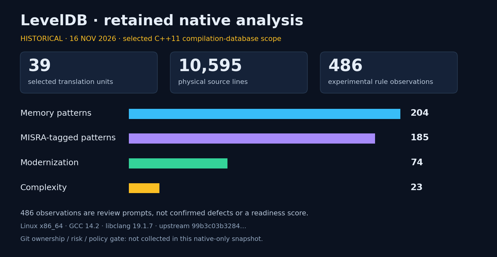

# cppulse

**C++ maintenance signals, backed by inspectable evidence.**

Find the code that deserves review, understand who has worked on it, and see
which checks support your next change. cppulse combines native C++ analysis,
Git history and configuration-scoped verification evidence in a local workflow.
It gives maintainers a review queue and library consumers a way to inspect what
upstream evidence actually covers—and what they still need to check themselves.

[Quickstart](#quickstart) · [Real OSS results](#see-a-real-project) ·
[Release workflow](#from-a-change-to-a-release-check) ·
[CLI guide](docs/development/public-cli.md) · [MIT license](LICENSE)

> **Development preview: 0.2.0.dev2.** Selected Linux component and installed-CLI
> journeys have been tested. Full production acceptance remains incomplete;
> [current status and limitations](#status-and-limits) are explicit.

## See a real project

This is a **historical Cloud analysis of LevelDB 1.23**, captured on
**16 November 2026**, not a scan by today's candidate. A fresh bounded run was
refused by the unchanged storage guard before analysis. The retained result was
recounted from its actual records and checked against the pinned upstream source.



| Observed scope or result | Retained value |
| --- | --- |
| Upstream revision | [`99b3c03b3284f5886f9ef9a4ef703d57373e61be`](https://github.com/google/leveldb/tree/99b3c03b3284f5886f9ef9a4ef703d57373e61be) |
| Selected compilation-database units | 39; all 39 reported analyzed |
| Physical lines in those source files | 10,595 |
| Actual rule observation records | 486 = 204 memory patterns + 185 MISRA-tagged patterns + 74 modernization + 23 complexity |
| Git ownership, ranking and policy gate | Not collected in this native-only run |

**What a maintainer learns:** these are concrete review prompts, not confirmed
bug counts. For example, `BuildTable` had reported cyclomatic complexity 13 and
nesting depth 3. The configured scope gives those measurements meaning; it does
not establish the readiness of every LevelDB build or consumer.

The recorded environment was Linux x86_64, GCC 14.2.0 and libclang 19.1.7, using
LevelDB's C++11 compilation database. The historical analyzer SHA-256 was
`f880711894e11b5ac13149b1ffeea0754c4a77f7a493ac794446c334264e9c5d`.

<details>
<summary>Actual recorded native command (historical environment)</summary>

```bash
/workspace/cppulse/analyzer-core/build-cloud-final/cppulse-analyzer \
  --repo /workspace/cppulse/work/six-corpus/leveldb \
  --output /workspace/cppulse/work/corpus-configured-evidence/leveldb/native \
  --compilation-database /workspace/cppulse/work/corpus-configured/leveldb/compile_commands.json \
  --resource-dir /workspace/cppulse/work/native-deps/usr/lib/llvm-19/lib/clang/19 \
  --file-list /workspace/cppulse/work/corpus-configured-evidence/leveldb/selection.json \
  --address-space-bytes 3221225472 --cpu-seconds 600 --file-size-bytes 268435456
```

These are recorded paths, not a fresh-run quickstart. Exact reproduction needs
that historical binary and environment; use a fresh output location. Substituting
the current analyzer produces a new measurement, not a reproduction of these counts.

</details>

[Inspect the results and reproduction record](docs/examples/leveldb/README.md) ·
[Machine-readable results](docs/examples/leveldb/results.json) ·
[All 486 observations](docs/examples/leveldb/observations.json) ·
[Selected-file metrics and source hashes](docs/examples/leveldb/source-metrics.json)

## What you can do today

| Your job | What cppulse provides |
| --- | --- |
| **Maintain a C++ codebase** | Inspect measured complexity, physical LOC, function size/nesting and exact lexical duplication alongside configurable rule findings. Prioritize review with available Git activity and experimental ranking. |
| **Understand ownership gaps** | Inspect selected-history churn and contributor concentration. Optional behavior configuration handles aliases, bots and pair attribution; historical co-change and team views carry their scope and limitations. Authorship is a knowledge proxy, not proof of expertise. |
| **Prepare a library release** | Collect explicit build/test/analysis recipes, retain source and artifact identities, and evaluate configurable policies over that declared scope. Keep passing, failing and missing evidence visible. |
| **Consume a library** | Compare retained upstream facts with your selected compiler options, source and consumer context. Identify local checks still needed for your macros, templates, headers and linked application. |
| **Review or automate a decision** | Read stored JSON/HTML reports, export SARIF, or run policy/finding gates through the CLI. Run/hash pins keep historical review tied to one retained snapshot. |

The native engine has **22 experimental, configurable pattern checks**. Findings,
measured metrics and parsing outcomes remain separate. Supported test, coverage,
compiler and sanitizer adapters preserve their original results and provenance;
normalization is specific to documented producer versions and input forms.

CTest/JUnit counts distinguish failed and skipped tests. LCOV line, branch and
function counters stay distinct; supported Cobertura supplies line/branch
counts. Neither analysis parse coverage nor branch coverage implies decision or
MC/DC coverage. See [coverage support](docs/development/coverage-normalization.md)
and [verification contracts](docs/contracts/verification.md).

### Keep four results separate

| Result | What it answers |
| --- | --- |
| **Measured maintenance health** | How observed findings relate to measured physical LOC and selected analysis contexts. The versioned density/context scorer exposes its formula, denominator and completeness; the historical descriptive scorer remains separately labeled. |
| **Experimental ranking** | Where review may be useful given available analysis and history. Heuristics and optional models are prioritization aids, without demonstrated predictive accuracy or calibrated defect probabilities. Missing inputs leave files explicitly unranked. |
| **Evidence completeness** | How much applicable policy weight has known results for the selected scope. Missing, stale or unsupported evidence remains unknown. |
| **Policy satisfaction and gate** | Which configured controls passed, failed or remain unknown, and whether the selected gate can pass. A health score is not substituted for test evidence or policy acceptance. |

For example, a real stored assessment can report
`"status": "insufficient_evidence", "exit_code": 3` while still retaining useful
findings and measured facts. That is an actionable gap: collect the missing
check rather than inherit an old green result.

## Quickstart

### Install from this development checkout

No published PyPI release or production binary bundle is assumed. Use Python
**3.11–3.12**, a C++17 compiler, CMake and a matching **LLVM 19+ libclang
headers/library pair**. Native dependencies include nlohmann/json, spdlog/fmt
and CLI11. Linux package names and LLVM prefixes vary by distribution.

From the checkout root:

```bash
python3 -m venv .venv
source .venv/bin/activate
python -m pip install -e '.[git]'

cmake -S analyzer-core -B build/native -DBUILD_TESTING=OFF
cmake --build build/native --target cppulse-analyzer --parallel 2
export CPPULSE_ANALYZER="$PWD/build/native/cppulse-analyzer"

cppulse doctor
```

Select the matching Clang resource directory with `CPPULSE_CLANG_RESOURCE_DIR`
if discovery needs help. It must contain the matching built-in headers, such as
`include/stddef.h`. `doctor` reports capabilities; finding an optional package
alone does not verify a producer execution. Native bundles and offline dependency
installation are covered in the [candidate guide](docs/development/candidate.md).

### Inspect the included synthetic fixture

```bash
cppulse analyze --repo demo/fixture --output output/first-run \
  --execution bounded --jobs 1 --no-history --format json

cppulse report --input output/first-run --evidence --format html \
  --output output/first-run/report.html
cppulse report --input output/first-run --evidence --format json \
  --output output/first-run/report.json
```

Open `output/first-run/report.html`. The fixture includes intentional rule
triggers; analyzing it does not execute those triggers. It has no Git history,
and this first-look run has no project compilation database. Inspect inferred
parse context and unavailable results instead of expecting a complete health or
ranking result. Exit 3 is meaningful partial/insufficient evidence, not a clean pass.

### Use your real build configuration

Generate a compilation database with your normal Makefiles/Ninja CMake build,
then give cppulse that configuration:

```bash
cmake -S /path/to/project -B /path/to/project/build \
  -DCMAKE_EXPORT_COMPILE_COMMANDS=ON

cppulse analyze --repo /path/to/project \
  --compilation-database /path/to/project/build/compile_commands.json \
  --execution bounded --jobs 2 --history \
  --output output/my-project --format json
```

Replace the placeholder project paths with your own. `analyze` does not build or
test the project. Git history needs Git and the optional `git` Python extra;
missing or bounded history is reported explicitly. Per-rule configuration,
exclusions and declared behavior identities are documented in the
[configuration reference](docs/generated/native-config.schema.json),
[Git history contract](docs/contracts/git-history.md) and
[behavior contract](docs/contracts/git-behavior.md).

## From a change to a release check

1. **Analyze the candidate in its actual configuration.** Review findings,
   available metrics and history gaps; choose the change you want to inspect.
2. **Collect relevant checks.** Declare the finite compiler, test, coverage and
   sanitizer commands and their inputs/outputs in a reviewed collection request.
   Existing tools remain the evidence producers.
3. **Evaluate your policy.** Select required contexts and explicit thresholds.
   Tests, measured thresholds, coverage kinds and scoped reviews have documented
   predicates; unsupported inputs cannot become clean results.
4. **Retain and review the decision.** Keep its run ID, manifest hash, policy,
   reasons and original artifacts. Recollect changed source or outputs before
   treating evidence as current.

With your own reviewed request and policy files (placeholder paths below):

```bash
cppulse collect --request /path/to/collection-request.json \
  --workspace /path/to/project --store /path/to/evidence-store
cppulse check --store /path/to/evidence-store \
  --workspace /path/to/project --policy /path/to/policy.json
cppulse report --input /path/to/evidence-store --evidence --format html \
  --output /path/to/evidence-report.html
```

`collect` executes only the declared recipe. A successful capture can retain a
failed test; it does not mean the policy passed. `check` evaluates retained
current material without silently rebuilding or rerunning tests. For historical
review, pass **both** `--run-id` and `--manifest-sha256`; a pinned old result stays
historical. [Request examples, gates and selectors](docs/development/public-cli.md).

| Check exit | Meaning |
| --- | --- |
| `0` | Selected gate passed |
| `1` | A configured gate has a known failure |
| `2` | Invalid input or an operational/capability error |
| `3` | Evidence is insufficient or the selected analysis is partial |

The same explicit recipe and gate can fit a local or CI workflow. The
[CMake/local-hook guide](docs/development/local-check-integrations.md) explains
opt-in checks; cppulse does not infer that an upstream sample covers every consumer.

## Local first, optional where you need it

The core is **MIT-licensed**, account-free and usable on public, private and
commercial projects. Core analysis can run offline after its dependencies and
matching native/resource packs are installed. Optional downloads and remote
provider commands still need network access. Third-party dependencies retain
their own licenses.

- **Browser or PDF:** optional `web` and `pdf` extras add API/dashboard serving
  and PDF rendering. The built dashboard is packaged; Node is for dashboard
  development. [Viewing stored results](docs/development/snapshot-web.md).
- **Editors and agents:** the [VS Code preview](docs/editor-vscode.md) and
  [read-only MCP preview](docs/development/mcp.md) expose selected stored results.
  Their finite preview scope is separate from full editor/platform qualification.
- **Extend the workflow:** registry-driven native checks, documented adapters,
  policy profiles and draft scaffolds support reviewed additions.
  [Rules](docs/generated/rules.md) · [Developer workflow](docs/development/workflow.md).

## Status and limits

Current capability is a development checkpoint, with selected Linux/native and
installed-CLI qualification. Ranking is experimental; scope and missing evidence
matter as much as a number. The real-project example above is explicitly a
historical native snapshot, not a current full-pipeline or upstream readiness verdict.

The full production plan remains incomplete. Source-bound delivery proof is
currently stale and its refresh is storage-blocked; the strict delivery checker
is not green. Broader platform/packaging, scale/resource, editor agreement and
other retained acceptance work remain open. Prose and demo assets do not close
those requirements. [Delivery status](docs/plans/production-delivery-status.md) ·
[Full completion plan](docs/plans/cppulse-production-completion-plan.md).

Try a configured run on your project, inspect the facts behind its result, and
bring a reproducible fixture when a finding or evidence boundary surprises you.
Contributions to rules, adapters and tests are welcome:
[development guide](docs/development/workflow.md) ·
[issues](https://github.com/manju89jay/cppulse/issues) · [license](LICENSE).
