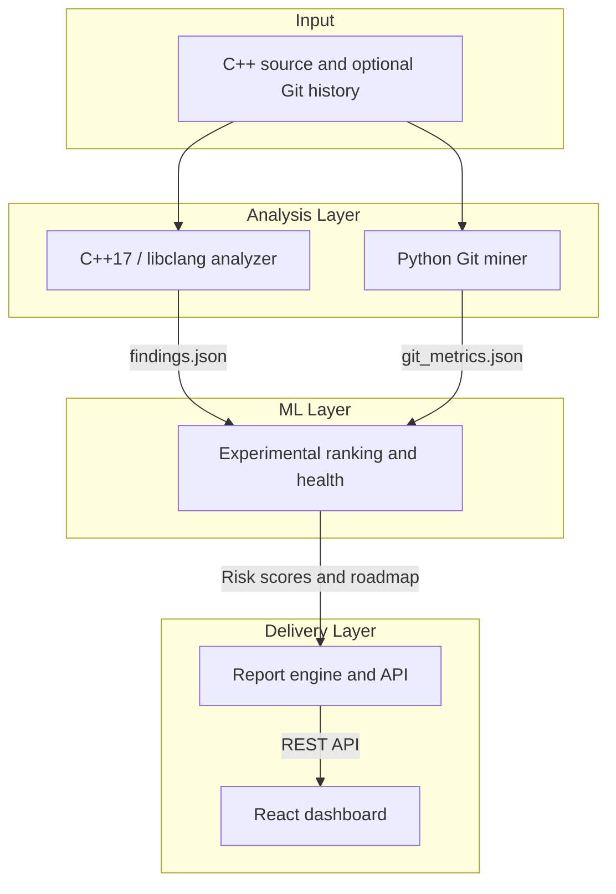

# cppulse

**Engineering prototype for C++ codebase analysis.** C++17/libclang checks,
Python Git mining and experimental ranking, explicit local verification recipes,
immutable evidence snapshots, PDF, FastAPI and a React dashboard. Scores are prioritization aids, not certification,
validated defect probabilities or production-readiness judgments.

## Current checkpoint: 0.2.0.dev2 (2026-11-14)

The S7 source checkpoint passes **all 15 shared checks, 2,499 tests and the
dashboard production build**. Public commands now collect explicit recipes,
assess retained facts, check policy or finding regressions, create baselines,
compare consumer evidence, explain historical runs and export SARIF. The
packaged API/UI and evidence JSON/HTML/PDF read the same manifest-bound snapshot;
the bundled dashboard needs no Node process at runtime. See
[public CLI](docs/development/public-cli.md) and
[shared results](review/autonomous/s7-shared-summary.json).

Fresh public C++ demonstrations produce passed, failed and insufficient-evidence
gates. The finding workflow exercises **24 public commands and 43 checked
snapshots**, including line shifts, stale headers, new findings, duplicate
basenames, ambiguous anchors and explicit rename limits. Completion of collection
or baseline creation is separate from a passed check. Missing proof stays unknown.

These are source-checkpoint results. **Final dev2 installed-candidate acceptance
is recorded separately in [S7 review](review/autonomous/S7-REVIEW.md) once
completed**; an older installed proof does not qualify these new artifact bytes.
The verified work is now preserved on the local review branch
`codex/cppulse-local-core-20261114`; no candidate has been published.
The verification records describe the original pre-commit worktree.

## Verified job-application demo

Baseline: `codex/job-application-demo-20261113` at
`b89dce9d22b37ef44843a68eb3373c525b4b8e94`, plus the stabilization work
now saved on `codex/cppulse-local-core-20261114`.
The fresh `output/s7-legacy-demo` synthetic two-file run produces **5 findings**, health **95.5**, heuristic
ranking and a readable **7-page PDF**. The clean file has no findings. This is a
functional demonstration, not an accuracy or performance benchmark.

Native CTest, Python suites, dashboard tests/build, artifact validation and the
built dashboard against the actual API were run in Linux. Docker is absent in
the verification environment: Compose definitions were corrected but **not
executed**. See [demo and verification](docs/portfolio/demo-verification.md).

After setup, the existing four-artifact demo remains `bash scripts/demo.sh`.
For the public evidence journey in the recorded cloud environment:

```bash
source review/environment.sh
PYTHONPATH=python python scripts/demo_evidence.py \
  --analyzer analyzer-core/build/cppulse-analyzer \
  --resource-dir "$CPPULSE_CLANG_RESOURCE_DIR" \
  --fixture demo/policy-fixture --output output/public-evidence-demo \
  --scenario all --formats json,html,pdf
```

Its summary pins actual captures, assessments, checks and reports. Use
`--formats json,html` for a core-only environment. This deliberately synthetic
recipe executes its selected native/CMake/CTest commands; loading a policy or
running `check` never silently builds the target project. The clean case also
exercises the opt-in CMake check and rejection of changed source/binary material.

## Quickstart: native checkout

Prerequisites: C++17 compiler, CMake, libclang development headers/library,
nlohmann-json, spdlog, fmt, CLI11 and GoogleTest CMake packages; Python 3.11/3.12;
Node 24; Pango/Cairo/font libraries for WeasyPrint. Ubuntu/Debian package names
include `g++ cmake libclang-dev nlohmann-json3-dev libspdlog-dev libcli11-dev
libgtest-dev libpango-1.0-0 libpangoft2-1.0-0 libcairo2 fonts-dejavu-core`.

Run from the checkout root:

```bash
python3 -m venv .venv
source .venv/bin/activate
CXX=g++ CC=gcc pip install -r git-miner/requirements.txt -r predictor/requirements.txt -r report-engine/requirements.txt -r requirements-demo.txt
cmake -S analyzer-core -B analyzer-core/build
cmake --build analyzer-core/build -j4
cmake -S cli -B cli/build
cmake --build cli/build -j4
(cd dashboard && npm ci && npm run build)
bash scripts/demo.sh
```

The reproducible demo command is **`bash scripts/demo.sh`** after setup.
It creates an explicitly synthetic local Git fixture in `tests/tmp/`, using
current timestamps and an automation identity, and records its revision in
`output/demo/fixture-revision.txt`. It never commits to this project or uploads.
Source contents are fixed in `demo/fixture/`; generated fixture commit IDs and
timestamps vary. Outputs include all four JSON contracts, `report.pdf`,
`report.json` (an aggregate JSON report), and extracted PDF text.

For a real checkout: `cli/build/cppulse analyze --repo /path/to/repo --output ./output/my-run`.
The legacy C++ CLI resolves caller-relative paths before entering component directories.
It uses its configured source checkout root; override with `--project-root` if
that checkout moves. Activate the Python environment before invoking it.
`--profile` controls scoring/ranking/roadmap; detector switches remain in config.
An explicit `--profile default` overrides a config profile.

Serve the fresh demo in two terminals:

```bash
(cd report-engine && DATA_DIR="$PWD/../output/demo" ../.venv/bin/uvicorn src.api:app --port 8000)
(cd dashboard && npm run preview -- --port 3000)
```

Open http://localhost:3000. The preview proxies `/api` to port 8000.
`python scripts/verify_web_demo.py` starts and stops both services and checks
routes, PDF download and every dashboard section. Install a Playwright Chromium
browser first, or set `CPPULSE_BROWSER` to an available Chromium executable.

For the canonical installed CLI, install the checkout with
`python -m pip install -e .` or install an exact prepared wheel/core lock. `cppulse serve --input
/path/to/run-store` serves the bundled built dashboard and API together; the
`web` extra is required. `cppulse report --input /path/to/run-store --evidence
--format pdf` additionally requires the `pdf` extra. Historical explicit run
selection uses the paired `--run-id` and `--manifest-sha256` options.

Optional Docker host: `REPO_PATH=/absolute/git/repo docker compose up --build`.
Outputs bind to host `./output` (override `OUTPUT_PATH`); `report-pdf` is a
successful one-shot job, while API/dashboard remain running. Use
`bash scripts/integration_test.sh` for local Compose verification. Docker was
unavailable here, so this path still needs execution on a Docker-capable host.

## Architecture

The legacy analysis pipeline exchanges JSON artifacts in `./output/`
([ADR-004](docs/adr/ADR-004-json-comms.md)). Explicit collection additionally retains
typed command receipts, source/output identities and original report/log bytes in
immutable local runs. Policy assessment, finding regression and historical views
consume those facts separately; they do not reuse a health score as verification.



### Data Flow

| Step | Component | Input | Output |
|-----:|-----------|-------|--------|
| 1 | **analyzer-core** | C++ source files | `findings.json` — findings from 22 registered checks unless disabled |
| 2 | **git-miner** | git log | `git_metrics.json` — 10 behavioral metrics per file |
| 3 | **predictor** | both JSONs | `risk_scores.json` + `roadmap.json` |
| 4 | **report-engine** | all JSONs | PDF report + REST API on :8000 |
| 5 | **dashboard** | REST API | Interactive visualization on :3000 |

### Component Stack

| Component | Language | Key Libraries |
|-----------|----------|---------------|
| [analyzer-core](analyzer-core/) | C++17 | libclang, nlohmann/json, spdlog |
| [git-miner](git-miner/) | Python | gitpython, pandas |
| [predictor](predictor/) | Python | xgboost, scikit-learn, pandas |
| [report-engine](report-engine/) | Python | FastAPI, Jinja2, WeasyPrint |
| [dashboard](dashboard/) | TypeScript | React, Recharts, Tailwind CSS |
| [cli](cli/) | C++17 | CLI11, spdlog |

## What You Get

A report with 7 sections:

| Section | What It Tells You |
|---------|-------------------|
| **Health Score** | Single 0-100 number. Memory safety weighted 3x. |
| **Category Breakdown** | Per-category scores: memory safety, modernization, complexity |
| **Hotspot Map** | Top 20 by change frequency × severity proxy × findings / max(age in years, 1) |
| **Detection Findings** | 22 registered checks unless individually disabled in config |
| **Knowledge Silos** | Files where only 1 person has committed in 12 months |
| **Bug Risk Ranking** | Experimental XGBoost ranking with conditional CV, or heuristic fallback below 50 file samples; labels can be noisy or feature-derived |
| **Refactoring Roadmap** | Prioritized suggestions with heuristic effort/impact estimates; no measured ROI |

## Historical examples: inconsistent totals

The stored examples and badges are historical, not fresh benchmark evidence.
The 2026-11-13 audit found these inconsistencies; no old totals were reused in
the synthetic demo and no historical files were regenerated.

| Example | Findings array / summary total | Sum by category | Sum by severity |
|---|---:|---:|---:|
| fmt | 372 / 372 | 1,769 | 2,856 |
| grpc | 38 / 38 | 9,408 | 56,844 |
| json | 177 / 177 | 618 | 1,119 |
| leveldb | 205 / 205 | 572 | 2,053 |
| poco | 77 / 77 | 14,533 | 25,821 |
| protobuf | 146 / 146 | 63,344 | 87,345 |

These artifacts cannot support comparative health, detection accuracy, complete
project coverage, throughput or production/safety claims.

## Detection Rules

All 22 detectors are registered by default. The default scoring profile excludes
MISRA from health/ranking/roadmap; it does not disable those detectors.
The seven checks labeled MISRA are a limited subset, not compliance verification.


<details>
<summary><b>Memory Safety</b> (3 rules, 3.0x weight)</summary>

| ID | Rule | Detects |
|----|------|---------|
| CPP-MEM-001 | Raw pointer ownership | `new` without smart pointer wrapping |
| CPP-MEM-002 | Manual memory management | Explicit `delete` / `delete[]` |
| CPP-MEM-003 | Unsafe array access | C-style arrays in function parameters |

</details>

<details>
<summary><b>Modernization</b> (9 rules, 1.0x weight)</summary>

| ID | Rule | Detects |
|----|------|---------|
| CPP-MOD-001 | C-style cast | `(int)x` instead of `static_cast` |
| CPP-MOD-002 | Deprecated headers | `<stdio.h>` instead of `<cstdio>` |
| CPP-MOD-003 | Missing override | Virtual method without `override` |
| CPP-MOD-004 | Raw string literal | Strings with excessive escaping |
| CPP-MOD-005 | auto opportunity | Verbose type declarations |
| CPP-MOD-006 | Range-for opportunity | Index-based loops |
| CPP-MOD-007 | nullptr vs NULL | Use of `NULL` macro |
| CPP-MOD-008 | Unscoped enum | `enum` without `class` |
| CPP-MOD-009 | typedef vs using | `typedef` instead of `using` |

</details>

<details>
<summary><b>Complexity</b> (3 rules, 1.5x weight)</summary>

| ID | Rule | Threshold |
|----|------|-----------|
| CPP-CX-001 | Cyclomatic complexity | warn > 15, error > 25 |
| CPP-CX-002 | Function length | warn > 80 lines, error > 150 |
| CPP-CX-003 | Parameter count | warn > 5, error > 8 |

</details>

<details>
<summary><b>MISRA-labeled subset</b> (7 checks; scoring weight 2.5x via <code>--profile safety-critical</code></summary>

| ID | Rule | Based On |
|----|------|----------|
| MISRA-001 | No goto | Rule 6.6.2 |
| MISRA-002 | No implicit narrowing | Rule 7.0.2 |
| MISRA-003 | No union | Rule 12.3.1 |
| MISRA-004 | No dynamic allocation | Rule 21.6.1 |
| MISRA-005 | No recursion | Rule 17.2.1 |
| MISRA-006 | Single exit point | Rule 15.5.1 |
| MISRA-007 | Initialize all variables | Rule 8.1.1 |

</details>

## Health Score

Current method: weighted findings divided by the eligible current attempted
source-file count (not KLOC), `weighted-findings-per-attempted-file-v2`:

```
health = clamp(100 - (3 * memory_findings + 1.5 * complexity_findings
                     + modernization_findings) / attempted_current_file_count, 0, 100)
```

The safety-critical scoring profile adds MISRA-labeled findings at 2.5x weight;
it is not a safety assessment. A complete nonempty eligible scope with active
rules and zero findings scores 100. Empty or materially incomplete analysis has
no full-scope health score. This does not measure verification completeness.

## Local build and hook integration

The opt-in CMake target and local hook template consume the same explicit
`cppulse check` engine. They do not collect or change refs automatically. See
[local integrations](docs/development/local-check-integrations.md).
The [action source](docs/action-usage.md) is a local check adapter whose Docker
and GitHub runner execution remain unverified. It does not post comments or
request a token; no new external CI workflow has been enabled or published.

## Development

### Prerequisites

- C++17 compiler and libclang development libraries; exercised with GCC 14.2/libclang 19 on Linux x86_64
- CMake/CTest 3.31.6 for the qualified verification adapters
- Python 3.12.14 exercised; declared package range is 3.11–3.12, with 3.11 unqualified here
- Node.js 24
- Docker & Docker Compose (for full-stack runs)

### Building

Use the root-level native quickstart above. The individual component commands below
are reference commands; return to the checkout root between components.

```bash
# C++ components
cd analyzer-core && cmake -B build && cmake --build build
cd ../cli && cmake -B build && cmake --build build

# Python components
pip install -r git-miner/requirements.txt
pip install -r predictor/requirements.txt
pip install -r report-engine/requirements.txt

# Dashboard
cd dashboard && npm ci && npm run build
```

### Compilation database

analyzer-core looks for `compile_commands.json` in the analyzed repo root (or its
`build/` directory) and parses each file with its recorded include paths, defines,
and language standard — falling back to bare `-std=c++17` when absent. Generate one
with `cmake -DCMAKE_EXPORT_COMPILE_COMMANDS=ON` to supply recorded include paths,
defines and language settings. Missing or unsupported contexts remain visible;
the exercised cases do not quantify an accuracy improvement.

### Testing

```bash
# From the repository root after setup: schemas, native CTest, each Python
# component with coverage, dashboard tests and production build.
python scripts/check_local.py

# Explicit optional Docker section; blocked when Docker is unavailable.
python scripts/check_local.py --section docker
```

### Linting

```bash
clang-tidy analyzer-core/src/*.cpp -- -std=c++17
ruff check . && black --check .
```

## Research References

- [Product discovery and working direction](docs/research/cppulse-product-discovery.md) -
  Consolidated findings, current source capabilities, C++ pain points, proposed
  distinctions, and maintainer/consumer workflows. Updated 2026-11-11;
  proposed capabilities and validation gaps are marked explicitly.
- [C++ analysis tool landscape](docs/research/cpp-analysis-tool-landscape.md) -
  High-level features, availability, and official sources for tools relevant to
  cppulse. Research snapshot dated 2026-11-05 for the goal-selection discussion.

## Architecture Decisions

| ADR | Decision | Rationale |
|-----|----------|-----------|
| [ADR-001](docs/adr/ADR-001-libclang.md) | Use libclang for AST analysis | Compiler parsing with explicit tested/partial contexts; detector coverage remains limited |
| [ADR-002](docs/adr/ADR-002-xgboost.md) | Experimental ranking | Conditional ML with heuristic fallback; predictive utility is not established |
| [ADR-003](docs/adr/ADR-003-monorepo.md) | Monorepo layout | Atomic changes across components, shared CI |
| [ADR-004](docs/adr/ADR-004-json-comms.md) | JSON for inter-component data | Schema-validated, human-readable, component isolation |
| [ADR-005](docs/adr/ADR-005-pdf-report.md) | WeasyPrint for PDF generation | HTML/CSS layout; requires native Pango/font libraries |

## Project Structure

```
cppulse/
  analyzer-core/    C++17 static analysis engine (libclang)
  git-miner/        Python git history analyzer
  predictor/        Python ML pipeline (XGBoost)
  report-engine/    FastAPI REST API + PDF generation
  dashboard/        React + TypeScript interactive UI
  cli/              C++17 CLI orchestrator
  docs/             ADRs, schemas, specs
  examples/         Showcase analyses of real C++ projects
```

## License

[MIT](LICENSE)

---

Built with libclang, XGBoost, FastAPI, React, and Docker.

## Autonomous implementation checkpoint

The staged core roadmap is being implemented in the working tree without
commits or remote writes. See [execution status](review/autonomous/STATUS.md)
and [S0/S1 technical review](review/autonomous/S1-REVIEW.md) for fresh results.
The current native run adds pinned fmt/utfcpp and a consuming application;
explicit incomplete compiler contexts remain visible. Run
`python3 scripts/run_real_corpus.py --fetch` to explicitly permit downloading
missing locked inputs, then build/test/analyze them. The upstream full test
suites are not run by this selected consumer example.

If a relocated libclang installation cannot find built-in headers such as
stddef.h, install its matching resource headers and use the analyzer's
`--resource-dir` or inherited `CPPULSE_CLANG_RESOURCE_DIR`. A resource directory
must contain include/stddef.h; invalid overrides fail clearly. The top-level
analyze/watch CLI now forwards `--compilation-database` files or directories.

## Versioned local foundation

The accepted S2 technical review adds packaged v2 contracts, conservative legacy readers, content identities and coherent local run snapshots. It passed 203 targeted checks, including the installation-metadata contract prerequisite. A completed collection and a passed policy are different results; S2 alone did not implement an evaluator. See [contracts](docs/contracts/v2.md) and [S2 review](review/autonomous/S2-REVIEW.md).

The S3 local wheel/native candidate passed fresh core-only installation with the original checkout path temporarily absent. It also analyzed an external application consuming the pinned fmt/utfcpp sources with its compilation database. Source entry points remain compatible. Schemas and templates live in the canonical cppulse namespace; component coverage includes that namespace because src modules are compatibility aliases. Docker, Windows and macOS remain unqualified. See [S3 review](review/autonomous/S3-REVIEW.md) and [candidate preparation](docs/development/candidate.md).

For a prepared candidate, create a fresh environment and use its exact offline
core lock (host native requirements still apply). Replace these placeholder
paths with the candidate/prefix recorded in its completed installed review:

```bash
candidate="/absolute/path/to/cppulse-0.2.0.dev2-linux-x86_64-candidate"
python3 -m venv /tmp/cppulse-demo-env
/tmp/cppulse-demo-env/bin/python -m pip install --no-index --find-links "$candidate/core-wheelhouse" --require-hashes -r "$candidate/core-requirements.lock"
export CPPULSE_NATIVE_PREFIX="/absolute/path/to/extracted/cppulse-native-0.2.0.dev2-linux-x86_64"
/tmp/cppulse-demo-env/bin/cppulse doctor
/tmp/cppulse-demo-env/bin/cppulse analyze --repo /path/to/cpp-project --output /tmp/cppulse-results --format html
```

The installed default generates self-contained HTML; JSON works in the same
core environment. PDF and API serving require their optional extras. `init`,
`config`, `doctor` and explicitly local redacted `diagnostics` are available.
Analysis runs the native analyzer and history/ranking/report components; it
does not run the target project's build. The public evidence commands use an
explicit request instead; see [public workflow commands](docs/development/public-cli.md).

Installed analysis retains coherent run snapshots and compatibility flat files.
Reports/API resolve one snapshot; newer incomplete attempts are visible rather
than silently reusing old results. Source binding for this archive-style analysis
is conservatively unverified. A completed collection is not a policy pass.

Directories without `.git` remain useful static-analysis inputs. Their history
metadata is explicitly unavailable; historical churn and positive Git hotspots
are not invented for them.

## Earlier S5 evidence checkpoint (2026-11-14)

The selected CMake/CTest/native workflow retains actual commands,
bounded logs, source/artifact identities and exact libclang parse contexts in
immutable snapshots. A pure policy evaluator supports finding limits, analysis
parse coverage, named test outcomes and required jobs. Missing, disabled, stale
or mismatched evidence cannot become a clean finding result. Policy scores stay
separate from experimental maintenance health/ranking.

The six-case synthetic demo verifies clean, intentional-finding, partial-parse,
disabled-rule, failed-test and missing-report outcomes. All 18 original/derived
snapshots verify. The fresh dev1 core-only installation reproduced one passed,
three failed and two insufficient-evidence gates outside the checkout, without
optional ML/PDF/web/Node. All 15 shared checks passed: **1,604 tests and dashboard
production build**. These are functional checks, not accuracy benchmarks.

In the recorded cloud environment:

```bash
source review/environment.sh
PYTHONPATH=python python scripts/demo_policy.py
```

On other configured hosts, select the analyzer/resource paths with the driver's
explicit options. See [walkthrough](review/autonomous/POLICY-DEMO.md),
[S5 review](review/autonomous/S5-REVIEW.md) and
[policy API](docs/development/policy-engine.md). The selected compiler/CTest
versions and finite resource inventory bound this historical S5 evidence. The
current S7 public workflow adds request validation, source and generated-output
freshness, policy-only reassessment with current expiry, and one snapshot view
across JSON/HTML/PDF/API/UI. A stale new attempt is visible without presenting an
old passed assessment as current. Historical pinned reads preserve their labels.
Docker/Compose is still unexecuted; no candidate has been published.

### Verification adapters and consumer applicability

The accepted S6 native source checkpoint passes **2,042 tests**, all 15 shared
checks and the dashboard production build. LCOV/Cobertura retain exact counts
and measurement kinds; explicit policy profile 1.1 adds coverage and sanitizer
predicates while omitted/1.0 retains the earlier four meanings. Actual selected
coverage is 5/8 lines and 1/2 branches; LCOV also records 2/3 functions. These
figures describe the deliberately small fixture, not cppulse detector accuracy.

Actual ASan/UBSan/TSan cases distinguish clean execution, real diagnostics and
unsupported proof. A recovering UBSan finding fails despite a successful CTest
exit. Pinned fmt/utfcpp distributed packages are compiled and consumed; compatible
upstream configuration remains separate from required local application tests.
Five consumer cases cover clean, missing-test, C++20 mismatch, a clearly synthetic
no-exceptions failure and a changed package. Transferred reports retain separate
source namespaces and unauthenticated import labels. Empty external diagnostic
reports never prove a complete clean scan.

```bash
source review/environment.sh
PYTHONPATH=python python scripts/demo_coverage.py --gcovr "$PWD/../tooling/gcovr-8.8/bin/gcovr"
PYTHONPATH=python python scripts/demo_sanitizers.py
PYTHONPATH=python python scripts/demo_consumer.py
```

See [S6 review](review/autonomous/S6-REVIEW.md),
[coverage](docs/development/coverage-normalization.md),
[consumer applicability](docs/development/consumer-applicability.md) and
[transfer](docs/development/evidence-transfer.md). Support is limited to the
recorded Linux/GNU/CTest dialects and selected finite inputs; runtime authenticity,
whole-program instrumentation and exhaustive template coverage are not proven.
The frozen dev1 installed proof predates S6/S7 additions. Current source
verification and final dev2 installed acceptance are separate records; consult
[S7 review](review/autonomous/S7-REVIEW.md) for the latter once completed.
