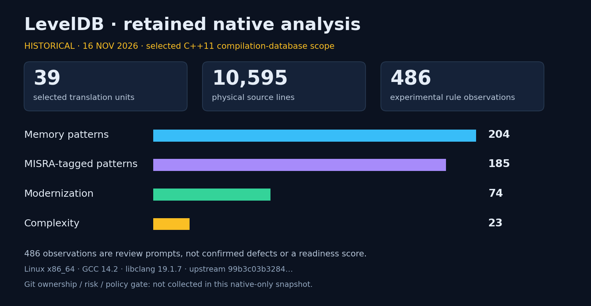

# LevelDB: an inspectable historical result

**Historical native-only analysis, captured 16 November 2026.** A one-file replay with the 19 November 2026 comparison candidate was refused by the resource guard before analysis. The counts remain from the 16 November run. [Exact refusal and attempted argv](fresh-run-status.json)

## Project, producer and scope

| Identity | Recorded value |
| --- | --- |
| Upstream | [google/leveldb](https://github.com/google/leveldb), tag 1.23 |
| Analyzed commit | [`99b3c03b3284f5886f9ef9a4ef703d57373e61be`](https://github.com/google/leveldb/tree/99b3c03b3284f5886f9ef9a4ef703d57373e61be) |
| Analysis timestamp | `2026-11-16T15:25:20Z` |
| Native executable SHA256 | `f880711894e11b5ac13149b1ffeea0754c4a77f7a493ac794446c334264e9c5d` |
| Platform / build compiler | Linux x86_64 / GNU 14.2.0 ([original configure log](configure-provenance.txt), [original host record](host-context.cmake)) |
| Parser | `Debian clang version 19.1.7 (3+b1)` |
| Declared context | 39 unique database translation units; C++11, POSIX library/leveldbutil, `-fno-exceptions -fno-rtti`; exact flags in [database](compile_commands.json) |
| Compilation database SHA256 | `fc219c31d586557664a345bc807301b4b1d78d7a0579d1faa625b167a73d91a0` |
| Original raw report SHA256 | `aee5cca53b7adbd1c8cf7e844d31b9fb0079cadc1a67686abbfc2266d227edf4` |

The artifact hash identifies the retained 16 November native producer. The 19 November comparison candidate had native SHA256 `1a34a3ad2a344728af729ec6d54c0277e01bac9503435e7462982d06f45d17c1`. These identities describe their recorded artifacts. Exact reproduction requires the matching binary and dependencies.

## What was observed



| Measurement | Actual retained value |
| --- | ---: |
| Selected database translation units | 39 |
| Units reported analyzed, without parse errors | 39 |
| Physical lines across those 39 source files | 10,595 |
| Actual finding records | 486 |
| Memory-pattern observations | 204 |
| MISRA-tagged pattern observations | 185 |
| Modernization observations | 74 |
| Complexity observations | 23 |
| Ownership / ranking / policy gate | Not collected |

The 486 records are experimental rule observations, **not 486 confirmed defects**. For example, raw allocation/deallocation patterns are review prompts in a manually managed codebase. MISRA-tagged patterns do not constitute a conformance assessment. No health score, calibrated probability, accuracy, benchmark or upstream readiness verdict is inferred.

A concrete maintenance lead: the historical producer measured [`BuildTable`](https://github.com/google/leveldb/blob/99b3c03b3284f5886f9ef9a4ef703d57373e61be/db/builder.cc#L17) with cyclomatic complexity 13 and nesting depth 3. That is a place to inspect control flow, not proof that refactoring is necessary or that behavior is incorrect. [Original selected function and per-file measurements](source-metrics.json).

Only the 39 selected compilation-database units were analyzed. Header consumers, duplicate target configurations, other compiler flags, template instantiations and runtime behavior remain separate scope. The native snapshot did not collect Git ownership or verification-policy evidence. A maintainer still needs relevant local build/test/coverage/sanitizer evidence for a release decision; upstream evidence cannot silently substitute for a consumer's configuration.

## Inspect the data

- [Machine-readable results and provenance](results.json).
- [All 486 observation records](observations.json), in original order. The export omits historical self-assigned `confidence`, which is not measured precision; original fields other than that value are retained. This documentation projection is not a current runtime schema.
- [All 39 file measurements, source SHA256s and effective parse arguments](source-metrics.json).
- [Unmodified original manifest and exact argv](native-manifest.json), [selection](selection.json) and [compilation database](compile_commands.json).

The publication audit recounted every record: category totals 204+185+74+23=486, severity totals 10+430+46=486, and per-file physical lines sum 10,595. All 39 reported source hashes were independently matched to `git show 99b3c03b3284f5886f9ef9a4ef703d57373e61be:path`. The cached worktree is now partially cold-archived; those immutable Git blobs establish which upstream source bytes the retained measurements name.

The complete 7,472,211-byte native report is retained in Cloud at `work/corpus-configured-evidence/leveldb/native/findings.json`, with the SHA256 above. Its bulk lexical-token/include payload and upstream source are intentionally not copied into Git. The public projections retain every finding record and all selected-file denominators; they do not substitute missing ownership, execution or readiness facts.

## Exact recorded command

This is the original captured argv rendered as shell text, **not a command to run over the retained output directory**:

```bash
/workspace/cppulse/analyzer-core/build-cloud-final/cppulse-analyzer \
  --repo /workspace/cppulse/work/six-corpus/leveldb \
  --output /workspace/cppulse/work/corpus-configured-evidence/leveldb/native \
  --compilation-database /workspace/cppulse/work/corpus-configured/leveldb/compile_commands.json \
  --resource-dir /workspace/cppulse/work/native-deps/usr/lib/llvm-19/lib/clang/19 \
  --file-list /workspace/cppulse/work/corpus-configured-evidence/leveldb/selection.json \
  --address-space-bytes 3221225472 \
  --cpu-seconds 600 \
  --file-size-bytes 268435456
```

Exact reproduction requires the matching historical executable, selected upstream commit, database and resource bytes, path layout and compiler environment. Preserve the original output and choose a fresh output directory. Another executable produces a new measurement. The recorded manifest covers the retained scope and leaves compiler, header and runtime dependency closure unestablished.

For a fresh project run with the current development CLI, follow the [README quickstart](../../../README.md#quickstart) and supply that project's actual compilation database. Source setup is separate from this retained result; no new upstream clone, build or test run was made to publish this page.

## Recreate the card

With the project's optional PDF/plot dependencies already installed:

```bash
python docs/examples/leveldb/render.py
```

The renderer reads only these committed JSON files, checks every public-artifact digest and recalculates the chart counts. Missing/inconsistent input fails before saving; it never downloads source, resets refs, runs an analyzer or fabricates a new successful result. The source data remain the historical snapshot.

LevelDB is a separate upstream project under its [BSD 3-clause license](https://github.com/google/leveldb/blob/99b3c03b3284f5886f9ef9a4ef703d57373e61be/LICENSE). No upstream source checkout is bundled here.
